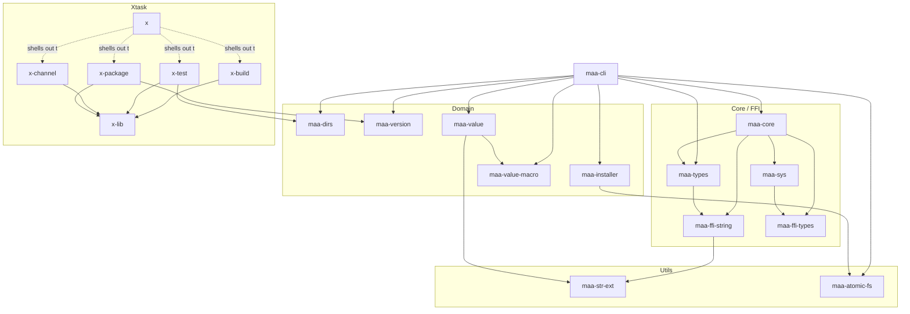

# Repository Guidelines

## Agent Checklist (Do This)

- Run `cargo +nightly fmt` first to normalize formatting.
- Run `cargo clippy` early to catch lint failures.
- Quick: `cargo test -p <crate>` for the edited crate(s).
- Local verification: `cargo x test` (build + tests).

## Architecture Overview (Understand This)

### Crate Map (Pick The Right Crate First)

**Application Layer:**

- `maa-cli`: CLI entry point, command routing, task orchestration, config handling, and installers. **Use when**: Adding commands, task presets, or installer logic.

**Core / FFI Layer:**

- `maa-core`: Safe wrapper over MaaCore. **Use when**: Changing `Assistant`, callback handling, MaaCore-facing error conversion, or other Rust-friendly MaaCore APIs.
- `maa-sys`: Raw MaaCore FFI bindings only. **Use when**: Adding new MaaCore API calls, updating signatures, or fixing linker / loader behavior. Keep `unsafe` here.
- `maa-types`: Shared enums/primitives (TaskType, ClientType, TouchMode, etc.). **Use when**: Adding new task types or MaaCore options.
- `maa-value`: Dynamic config values with conditional parameters and user input prompts. **Use when**: Handling task parameters, merging configs, or prompting users.
- `maa-ffi-types`: Primitive FFI aliases (`AsstBool`, `AsstId`, `AsstSize`, ...). **Use when**: Adjusting low-level MaaCore ABI-facing types.
- `maa-ffi-string`: UTF-8 `CString` helpers for FFI. **Use when**: Passing Rust strings to MaaCore C API.

**Domain Layer:**

- `maa-dirs`: OS-specific path resolution with XDG support. **Use when**: Accessing config/cache/state/resource directories or finding the MaaCore library.
- `maa-installer`: Download/extract/verify with manifest support. **Use when**: Adding update sources or improving download reliability.
- `maa-version`: Version manifest parsing and comparison. **Use when**: Handling version checks or update logic.
- `maa-value-macro`: Proc macros for `MAAValue` construction. **Use when**: Building complex config objects in code.

**Utils Layer:**

- `maa-str-ext`: UTF-8 conversion for `OsStr`/`Path`/bytes. **Use when**: Dealing with strings that might not be UTF-8. This is a generic utility crate, not a MaaCore-specific abstraction.
- `maa-atomic-fs`: Atomic single-file replacement (same-directory staging, fsync, rename). **Use when**: Writing or replacing a file that must never be left partially written, such as configs, caches, or release metadata.

**Tooling Layer:**

- `x-lib`: Shared environment, command, log grouping, and workspace path helpers.
- `x-build`: Build automation. **Use when**: Changing builds or license generation.
- `x-test`: Test automation. **Use when**: Changing workspace test orchestration.
- `x-channel`: Release index channel selection using SemVer. **Use when**: Changing channel promotion rules.
- `x-package`: Release artifact packaging and manifest generation. **Use when**: Changing release archives or manifests.
- `x`: Dependency-free launcher for the xtask crates. **Use when**: Adjusting `cargo x ...` forwarding behavior.

## Critical Patterns

- **Paths**: Always use `maa-dirs` for directory resolution. Never hardcode paths like `/usr/local/share` or `C:\Program Files`. The crate handles platform differences and environment overrides (`MAA_CONFIG_DIR`, etc.).
- **FFI Boundary**: Keep `unsafe` confined to `maa-sys`. `maa-core` is the safe wrapper layer. Other crates should never call MaaCore directly.
- **Error Handling**: `maa-cli` uses `anyhow::Result` for application errors. Libraries use `thiserror` for structured errors. Never use `unwrap()` without a safety comment.
- **File Replacement**: Use `maa-atomic-fs` instead of `fs::write`/`File::create` when overwriting configs, caches, or other files that readers rely on. It does not lock or coordinate multiple files.
- **String Conversions**: Use `maa-str-ext` for `OsStr`/`Path` ↔ UTF-8, and `maa-ffi-string` for MaaCore FFI `CString` conversion. Handle non-UTF-8 gracefully.
- **String Formatting**: When using `format!` and related macros (`write!`, `log::info!`, `bail!`, etc.), always inline variables into `{}` placeholders. Example: use `format!("Error: {error}")` instead of `format!("Error: {}", error)`.

## Code Quality & Safety

- Formatting and linting are required; follow the checklist.
- Clippy warnings fail CI; use `#[allow]` or `#[expect]` with a short reason when unavoidable.
- Errors: `maa-cli` uses `anyhow`; libraries use `thiserror` or explicit error types.
- Avoid `unwrap`/`expect` and `unsafe`; if used, add a brief justification comment.

## Testing Rules

- All changes must be covered by tests，except FFI or external network access.
- Prefer unit tests with `#[test]`; add regression tests for bug fixes.
- Mark tests `#[ignore]` only when they require external network access or read/write system or user home directories.
- Tests using local `test_server` helpers or writing under `temp_dir()` are OK and should not be ignored.
- Run ignored tests explicitly with `cargo test -- --ignored` when needed.

## Documentation Rules

- Update docs when commands or config behavior changes.
- Primary language is Simplified Chinese; add English when practical.
- One paragraph per line; use ` ` for line breaks only when needed; no trailing spaces.
- Markdown is linted by `markdownlint-cli2`.

## Contributing on Behalf of a Human (Follow This)

If you are an agent helping someone prepare a PR, follow [CONTRIBUTING.md](CONTRIBUTING.md). In particular:

- **Check for an agreed design first.** For a new feature, command, config option, config format change, or anything likely to exceed about 500 lines, confirm there is an issue where a maintainer agreed on the approach. If there is none, stop and tell your human to open one instead of implementing.
- **Stay in scope.** Implement only what the task needs. Do not add unrequested flags, subcommands, options or refactors. Report unrelated problems to your human instead of fixing them in the same PR.
- **Keep the diff lean.** No explanatory comment blocks, no speculative defensive code, no design notes or conversation summaries committed to the repo.
- **Follow existing patterns.** Look for how the codebase already solves a problem (tests included) before inventing a new mechanism.
- **Your human reviews before anything is published.** Do not open or push a PR until your human has read the whole diff. Never tick the self-review checkbox in the PR template for them.
- **Write the PR description from the template.** Keep it short, fill in the AI assistance section honestly, and do not paste long generated summaries.
- **Do not ghost-write review replies.** Help your human understand review feedback; the reply on GitHub should be in their own words.

## MISC

- Use conventional commits: `feat: ...`, `fix: ...`, `refactor: ...`, `perf: ...`, `docs: ...`, `test: ...`, etc.
